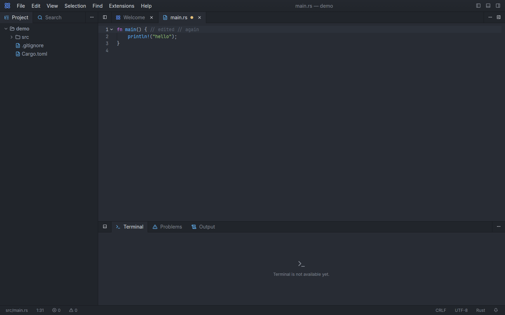

# Nucleus

Rust と [gpui-kit](https://gpui-kit.com) で作る、Atom の雰囲気をもつネイティブのコードエディタです。
Core は小さく速く保ち、機能はすべて Extension で足します。

- 設計: [`docs/ARCHITECTURE.md`](docs/ARCHITECTURE.md)
- デザイン（gpui-kit のトークンと Atom One の配色、画面一覧）: [`docs/design/HANDOFF.md`](docs/design/HANDOFF.md)



## 構成

| crate | 役割 |
|---|---|
| `crates/nucleus` | 起動 |
| `crates/theme` | Core Token（`tokens.yaml` から生成）、Nucleus One Dark / Light、拡張 Token、gpui-kit への適用 |
| `crates/i18n` | Fluent による多言語化（英語・日本語、言語パック） |
| `crates/project` | 開いているフォルダのツリー（遅延読み込み、`.gitignore`、ファイル監視） |
| `crates/editor` | エディタパネル（gpui-kit の code editor、読み書き、改行コードの保持） |
| `crates/terminal` | ターミナル（alacritty_terminal、テーマの ANSI 色） |
| `crates/settings` | 設定（既定 / ユーザー / フォルダの3層、コメント付き JSON） |
| `crates/lsp` | LSP クライアント（JSON-RPC、専用スレッドで読み書き） |
| `crates/extension_host` | Extension の読み込みと検証、起動後の段階的な反映、WASM の実行（wasmtime） |
| `crates/extension_api` | Extension 作者向けの SDK と WIT（`nucleus:extension@1.0.0`） |
| `crates/workspace` | メインウィンドウ（TitleBar / DockArea / StatusBar）、パネル、コマンドパレット、ファイル検索、セッション |

## ビルドと実行

Linux では次のライブラリが必要です（Ubuntu / Debian）:

```bash
sudo apt-get install -y libxkbcommon-dev libxkbcommon-x11-dev libwayland-dev libvulkan-dev libx11-xcb-dev libfontconfig1-dev libfreetype-dev
```

```bash
cargo run -p nucleus
```

フォルダやファイルを引数で渡すと、それを開いた状態で起動します。

```bash
cargo run -p nucleus -- path/to/project
```

| キー | 操作 |
|---|---|
| `Ctrl+Shift+P` / `F1` | コマンドパレット |
| `Ctrl+P` | ファイルへ移動 |
| `Ctrl+Shift+F` | プロジェクト全体を検索・置換 |
| `Ctrl+O` | フォルダを開く |
| `Ctrl+S` | 保存 |
| `Ctrl+W` | タブを閉じる |
| `Ctrl+F` / `Ctrl+H` | ファイル内を検索 / 置換（`F3` / `Shift+F3` で次 / 前） |
| `Ctrl+,` | 設定ファイルを開く |
| `Ctrl+`` ` `` / `Ctrl+Shift+T` | ターミナルの表示切り替え / 新しいターミナル |
| `Ctrl+Shift+V`（ターミナル内） | 貼り付け |
| `F12` | 定義へ移動 |
| `Ctrl+Alt+S` | 行を並べ替える（組み込み Extension「Word Tools」） |
| `Ctrl+Alt+B` → Git | 変更の一覧・ステージ・コミット（組み込み Extension「Git」、コミットは `Ctrl+Enter`） |
| `Ctrl+B` / `Ctrl+J` / `Ctrl+Alt+B` | 左 / 下 / 右のドックを開閉 |
| `Ctrl+Q` | 終了 |

表示言語は OS の設定に従います。設定ファイル（`~/.config/nucleus/settings.json`）の `"language"` か、環境変数 `NUCLEUS_LANG=ja` で切り替えられます。前回開いていたフォルダとファイルは、次回の起動時に復元されます。

設定の例（保存すると即座に反映されます）:

```jsonc
{
  "theme": "Nucleus One Light",
  "language": "ja",
  "editor": { "font_size": 14, "tab_size": 2, "soft_wrap": true },
  "keymap": [{ "key": "ctrl-shift-e", "command": "workspace::ToggleLeftDock" }]
}
```

```bash
cargo test --workspace
```

```bash
cargo clippy --workspace --all-targets
```

色はテーマの Token からしか取れません。`theme` クレート以外で `gpui::rgb()` などを使うと clippy がエラーにします。

## ライセンス

MIT または Apache-2.0。同梱フォントのライセンスは `assets/fonts/` を参照してください。

## Extension を作る

Extension は `extension.yaml`（名前・権限・提供するもの）と、必要なら WASM 1つでできています。WASM を持つ Extension は Rust で書けます（例: コマンドだけの `extensions-src/word-tools`、ドックに画面を出す `extensions-src/git`）。

```bash
rustup target add wasm32-wasip2
```

```bash
./extensions-src/word-tools/build.sh
```

できたフォルダを `~/.local/share/nucleus/extensions/<名前>/` に置くと、次の起動で読み込まれます。権限と API の詳細は `docs/ARCHITECTURE.md` を参照してください。
