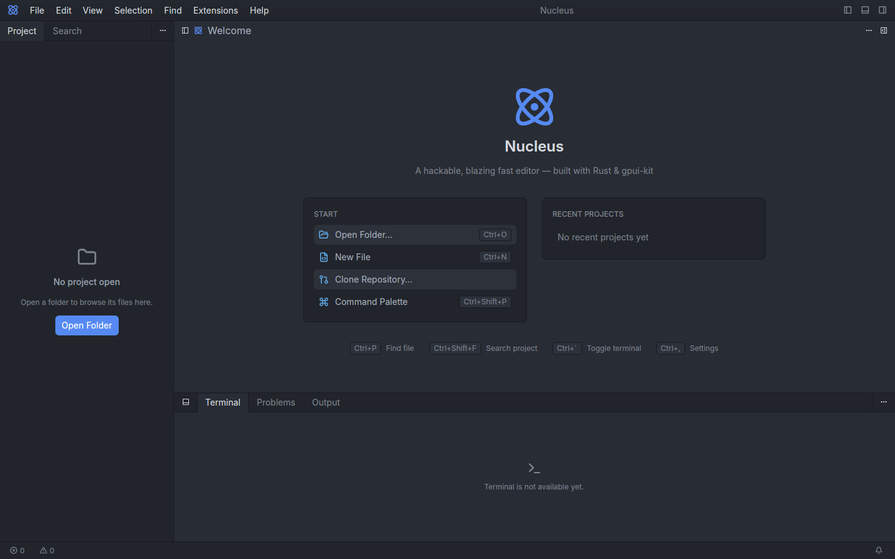

# Nucleus

Rust と [gpui-kit](https://gpui-kit.com) で作る、Atom の雰囲気をもつネイティブのコードエディタです。
Core は小さく速く保ち、機能はすべて Extension で足します。

- 設計: [`docs/ARCHITECTURE.md`](docs/ARCHITECTURE.md)
- デザイン（gpui-kit のトークンと Atom One の配色、画面一覧）: [`docs/design/HANDOFF.md`](docs/design/HANDOFF.md)



## 構成

| crate | 役割 |
|---|---|
| `crates/nucleus` | 起動 |
| `crates/theme` | Core Token（`tokens.yaml` から生成）、Nucleus One Dark / Light、拡張 Token、gpui-kit への適用 |
| `crates/i18n` | Fluent による多言語化（英語・日本語、言語パック） |
| `crates/workspace` | メインウィンドウ（TitleBar / DockArea / StatusBar）とパネル |

## ビルドと実行

Linux では次のライブラリが必要です（Ubuntu / Debian）:

```bash
sudo apt-get install -y libxkbcommon-dev libxkbcommon-x11-dev libwayland-dev libvulkan-dev libx11-xcb-dev libfontconfig1-dev libfreetype-dev
```

```bash
cargo run -p nucleus
```

表示言語は OS の設定に従います。`NUCLEUS_LANG=ja` のように指定して切り替えることもできます。

```bash
cargo test --workspace
```

```bash
cargo clippy --workspace --all-targets
```

色はテーマの Token からしか取れません。`theme` クレート以外で `gpui::rgb()` などを使うと clippy がエラーにします。

## ライセンス

MIT または Apache-2.0。同梱フォントのライセンスは `assets/fonts/` を参照してください。
